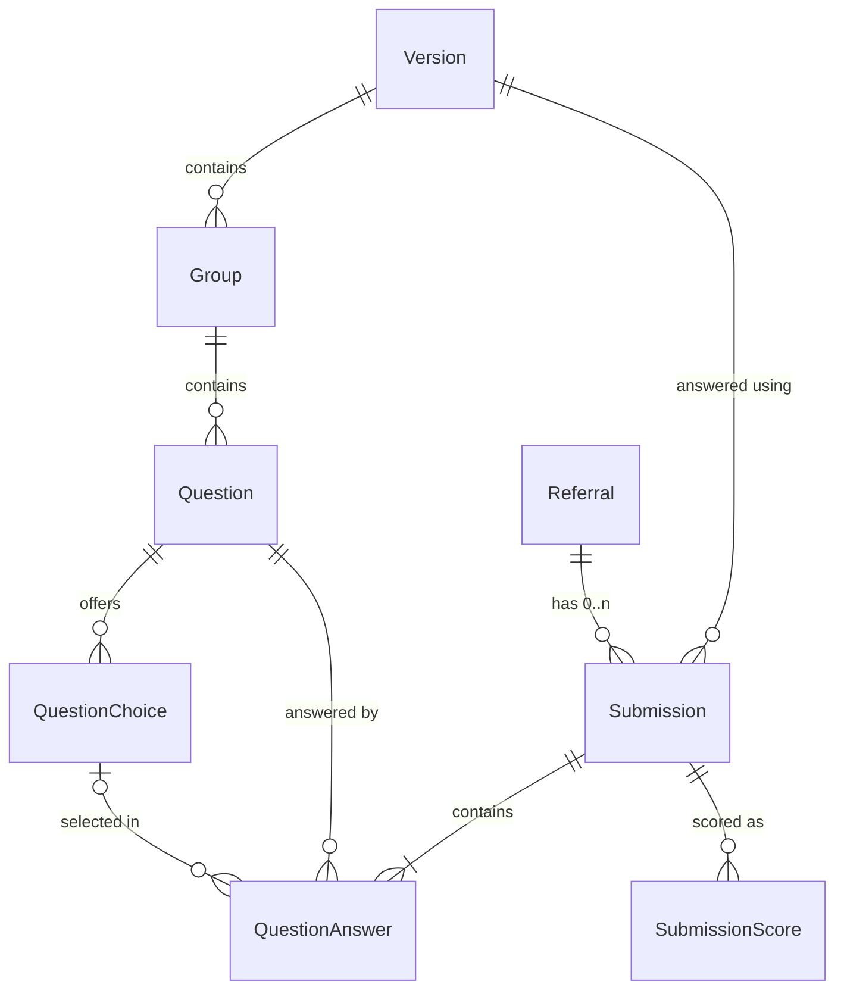
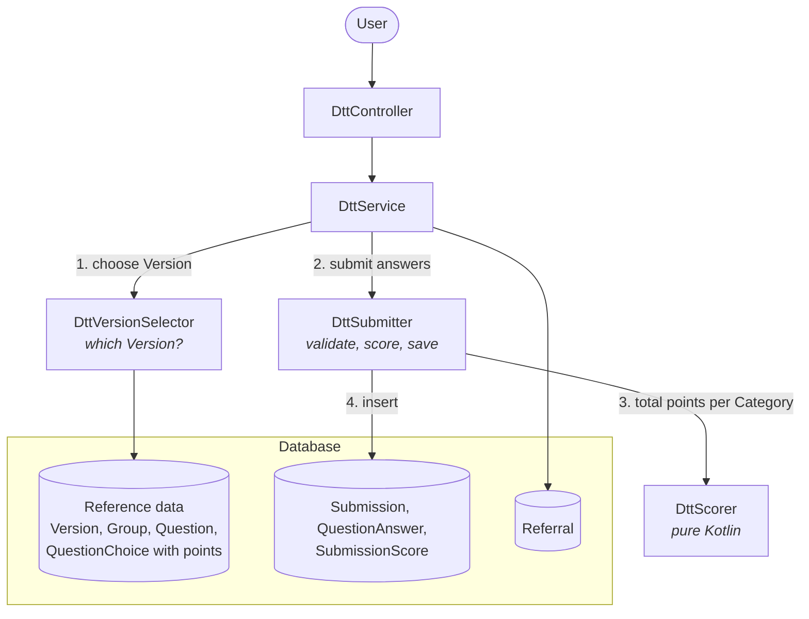

# Design Document: Distance Travelled Tool

> [!NOTE]
> This is a draft document, created ahead of the initial implementation of the Distance Travelled Tool.  It has not been thoroughly reviewed by the team, and should be considered as guidance and a starting point, rather than anything prescriptive.  --Wilson 2026-11-19

## Scope

This document proposes technical foundations for building the Distance Travelled Tool (DTT) inside of the Community Support Service. 

The intention is to produce a first direction of travel to begin implementation, it does not dictate an architecture which must be followed.

### Likely not in the MVP

These have been considered and consciously deferred, but may well be necessary eventually:

- **Draft Submissions.**  We only record data after it's been submitted, i.e. we don't record a Survey in Progress.
- **Reporting and data export.** How Submissions and Scores reach MI or the data warehouse is not designed here. Stable `question_key`s and a simple per-Category `SubmissionScore` table should make this straightforward to add later.
- **Mapping similar questions across Versions.** For reporting, we may need to treat similar but not identical Questions in different Versions as the same. A simple question-to-question mapping or grouping would cover this, but nothing needs it until a second Version exists.
- **Version selection rules.** There is one Version, and everyone gets it. Rules for who gets which Version are deferred until a second Version exists (see [Versioning and Version Selection](#versioning-and-version-selection)).

## Business Context

The 'Distance Travelled Tool' is an idea that came from the CRS / Community Support programme, borne out of a desire to have a way of measuring the effectiveness of CRS (now Community Support) interventions.

There is a questionnaire which was developed through academic research which measures someone's 'Justice Capital score' - known as J-CAP. 

The MoJ have procured this questionnaire as this is what they would like to carry out at a series of intervals, to determine how far someone has come on their rehabilitative journey i.e their "distance travelled".

The CRS service needs to support delivery of a digital tool to administer the measure, calculate scores, and support reporting. 

Altough there is an existing J-CAP digital tool, for pragmatic, logistical reasons, the re-building of a new digital service was seen as the better option.

Design, User Research, and Information Architecture work started on the DTT within the wider team around July 2026.

## Similarities (and differences) to the Action Plan

There are immediate similarities between this problem and the Action Plan (see [the sibling design doc](./2026-08-action-plan-design-document.md)).

Namely that there is a structured questionnaire that we have to fill out on behalf of the user.

I do not believe it would be appropriate to copy the Action Plan design pattern whole-cloth, because there are the following differences:

1. Each Referral has one singular Action Plan, which evolves and changes - where we keep a log of changes to specific questions.  A J-CAP score may be calculated many times for an individual Referral, but each time is separate.
2. The DTT's questions are fixed and almost entirely multiple choice, and every multiple-choice question must be answered. The only optional questions are free-text comments, which are never scored. The Action Plan has a much greater diversity of free-form and optional questions, whose answers change at different times.

The solve this, the Action Plan relies heavily on a Header-Details design pattern, where we track all previous answers given to a specific question.

Doing so introduced significant technical complexity, especially around edge cases (e.g. answering a question, removing that answer, and then providing a new answer).

For the DTT, we should not inherit this complexity, because the problems are simply different.

Instead, everything in the DTT is write-once. Questions never change once published, and a Submission, its Answers and its Scores are never edited after they are saved. Because nothing changes, the stored data is already the audit trail, and we do not need a separate mechanism to record history. The DTT therefore has no Header/Details split, no `revision_number`, no per-answer soft-delete, no batch IDs and no answer event tables.

## Data Model Design

This section outlines the core functionality consideration, and proposes pragmatic solutions for them.

### A Proposed Data Model

To cut to the punch-line, we arrive at a data model that looks something like this:



_Note: All tables in our database will use the `distance_travelled_tool` prefix, omitted here for brevity.  Likewise, reference data tables (Version, Group, Question and QuestionChoice) will be prefixed with `reference_data_`, matching existing tables such as `reference_data_action_plan_step_question`. Kotlin classes use the shorter `Dtt` prefix, e.g. `DttSubmission` and `ReferenceDataDttQuestion`._


### Questions, Answers, and Submission

The core of the experience is the ability to be presented with Questions, propose Answers to the Questions, and then Submit a set of answers.  Because the survey can be completed multiple times for the same Referral, we will call a specific collection of Answers a Submission.  

- **`Question`**: one question within a Version, as presented to the user: its `text`, `label`, `hint`, `order_number`, `question_key` and `answer_type` (`CHOICE` or `FREE_TEXT`, see below). Questions are reference data: they are created by Flyway seed scripts and never written or edited at runtime. Question wording is always generic and in the second person, so it is shown exactly as stored, with no per-person placeholders to fill in. A `required` flag marks which Questions must be answered: every multiple-choice Question is required, while free-text comment Questions are optional. A skipped optional Question has no Answer row.
- **Answer** (`QuestionAnswer`): the answer to one Question in one Submission (`submission_id`, `question_id`, and either `choice_id` or `free_text`, depending on the Question's `answer_type`). There is at most one Answer per Question per Submission. An Answer is linked to its Question through `question_id`, and reaches its Version through its Submission (Answer → Submission → Version) rather than storing its own `version_id`. Because Question wording has no placeholders, and published Questions and Choices never change, the reference rows are themselves the record of exactly what the person was shown. The Answer does not need its own copy of the text.
- **`Submission`**: one completion of the DTT, for one Referral, against one Version (`referral_id`, `version_id`, `created_at`, `created_by`). A Referral has 0..n Submissions, each independent of the others. Submitting is all-or-nothing: the Submission, all of its Answers and all of its Scores are written in one transaction, so there is no draft or partly completed state. A Submission links to a Referral only; history across a person's Referrals comes through `referral.person_id`, not a `person_id` column of its own.

Submissions and Answers are insert-only, and there is no way for a user to withdraw a Submission once it is made. The only exception is removal by a technical colleague, described in [Removing Data](#removing-data).

### Multiple Choice and Free-Text Questions

Most of the survey is quantitative, i.e. the user selects an answer from a pre-defined list.  These are both categorical (e.g. "YES"/"NO") and ordinal (e.g. "Strongly Agree", "Agree", etc.).   We therefore need to model the possible Answers to a Question, which we can do through a Question Choice.

- **`QuestionChoice`**: one possible answer to a multiple-choice Question: its `label` (as shown to the user), `value`, `order_number`, and the score it awards (`score_category` and `points`, see [Scoring](#scoring)). `value` is a stable text code such as `AGREE`, which identifies the Choice in requests and reporting.

Alongside these, the survey includes free-text Questions that let the user add comments on each part of the survey. Free-text Questions have no Choices, are optional and are never scored, but their answers are stored like any other, in the Answer's `free_text` column. Free text may contain personal or sensitive information, which matters when [removing data](#removing-data).

### Grouping Questions

Completing the survey takes the user through many pages. Rather than leaving the UI to decide which Questions appear together, and in what order, the API owns this. This mirrors the Action Plan, whose Steps correspond roughly to screens in the UI.

- **`Group`**: an ordered set of Questions shown together, typically one page of the survey (`version_id`, `order_number`, `title`). A Version has many Groups, and each Question belongs to exactly one Group. A Question's `order_number` is its position within its Group.

The UI walks through a Version's Groups in order, one Group per page. Groups only describe the questionnaire's structure: Answers are not stored per Group, and a Submission is still made once, at the end. What that means for a long, multi-page survey is an [open question](#open-questions).

### Scoring

Once a user has submitted their Answers, a pre-defined "scoring engine", i.e. a deterministic evaluator of the selected answers, presents the user with a Score.  We will call this the Submission Score.  

This is the quantitative representation of the Justice Capital (J-CAP) mentioned in the Business Context.  

Scores are deterministic (i.e. the same answers will always give the same score) and immutable, i.e. they will not be re-calculated post-submission - they remain a point-in-time understanding or evaluation.

Scoring works at the level of a single Choice. Each Choice awards a number of points (usually between -1 and 1) in a Category, and the Category depends on which Choice is selected. For example, Question A might offer YES or NO: answering YES awards 1 point in Category X, while answering NO awards -1 point in Category Y. At the time of writing the Categories are Strengths, Weaknesses and Neutral, and the survey as a whole is geared towards measuring a person's strengths and weaknesses. The Categories may change in future Versions.

A Submission's Scores are the points awarded by its Answers, totalled by Category. Free-text Answers are not scored.

- **Scoring rules** live on `QuestionChoice`, as `score_category` and `points`. Because they are reference data, they are versioned and immutable along with the Questions they belong to. `score_category` is a text column with a check constraint, in line with our convention for enum-like values. A new Category is added by a migration alongside the Version that introduces it.
- **`SubmissionScore`**: one Category's total for one Submission (`submission_id`, `score_category`, `total`). Scores are written in the same transaction as their Submission. Totals could be recalculated from the Answers, but storing them freezes the result shown to the user as evidence. It also keeps that result unchanged if the way totals are calculated is later revised.

We know less about scoring than any other part of this design. In particular, we have assumed that a Category's total is a simple sum of points, which is not yet confirmed (see [Open Questions](#open-questions)). Where the arithmetic lives is covered in [Scorer](#scorer).

### Versioning and Version Selection

We should be prepared for the shape of the DTT to change.  This could incllude changes to the scoring criteria, material changes to the questions (e.g. adding new questions or removing old ones), as well as superficial changes (e.g. re-wording existing questions or changing the order).

We will call a collection of Questions and Question Choices a Version.  We should be prepared for a new Version to be created, and to roll out in non-trivial ways.  For example, imagine V1 is replaced by V2.  It may be that V2 is only given to users who do not have any previous Submsssions associated with V1, or it may be that V2 relates only to Referrals for individuals in a specific indivdual, or it the version may be at the discretion of the Probation Practitioner or Delivery Partner.

- **`Version`**: one published version of the DTT. It has a unique `readable_id` (e.g. `v1.0`) and an `active_from` date. It owns its Groups, Questions and Choices, and with them its scoring rules. `active_from` replaces the Action Plan's `activeGlobal` boolean: rather than flagging one row as "current", we record when each Version comes into force.
- **`Group`**, **`Question`** and **`QuestionChoice`**, as described above, each belong to exactly one Version (Questions and Choices through their Group). `question_key` is unique within a Version; a database constraint can't span Groups, so a test over the seed data checks this. `question_key` stays the same across Versions for the same question, so answers to it can be followed from one Version to the next. Any change to a Group, Question or Choice, whether its wording, order, choices or points, is made by creating it again in a new Version, never by editing existing rows.

These tables require that:

- **Published data is immutable.** Version, Group, Question and QuestionChoice rows are never updated or deleted once published.
- **Versions are published through Flyway seed scripts only.** New Versions are added in `db/seed`, never written at runtime. Immutability is kept by convention and code review (see the [Code Review Checklist](#code-review-checklist)), not by a database trigger.
- **Version selection happens in code, not data.** For the MVP there is one Version for everyone: the latest Version whose `active_from` has passed. Rollout rules like the examples above belong in the [Version Selector](#version-selector) once a second Version exists. Each Submission stores its own `version_id`, so changing those rules never affects past Submissions.

### Removing Data

There is no way for a user to withdraw or archive a Submission. However, a technical colleague may occasionally need to remove a Submission from the system entirely, for example in response to a data protection request, or because it was recorded against the wrong Referral. Free-text Answers make this more likely, since they can contain personal information.

We propose that this is a hard delete, not a soft delete: the aim is that the data no longer exists, and a soft-deleted row still holds it. To keep this simple and safe:

- **Deletes cascade.** `QuestionAnswer` and `SubmissionScore` reference their Submission with `ON DELETE CASCADE`, so deleting a Submission removes everything that belongs to it in one statement. Anything that references a Submission in future must cascade in the same way.
- **Removal is an operational procedure, not a feature.** It is carried out with a reviewed, documented SQL script or runbook, not through an API endpoint or application code.

Whether we also need a record that a removal took place, without the removed data, is an [open question](#open-questions).


## Service Layer Design

Alongside the core entities, there are several key areas of domain logic or business process.  These are described below.  The intention of this design is to identify discrete areas of logic and responsibility, and prevent a single class (historically the Service layer) becoming over-burdened.

The Kotlin snippets below are sketches, not specifications: they show the shape of each class and how they fit together, and the names and signatures are expected to change during implementation.

### DTT Service

The `DttService` is the DTT's entry point for controllers. Taking inspiration from Domain Driven Design, its public methods should read as the things a user does, in the language of the domain, and not as the database operations needed to do them.

The nouns are the entities described above: a **Referral** answers a **Version** of the questionnaire, made up of **Groups** of **Questions** and their **Choices**, producing a **Submission** of **Answers** that is given **Scores**. The verbs are:

- **Present the questionnaire** for a Referral: choose the Version the Referral should answer, and return its Groups, Questions and Choices in order.
- **Submit answers** for a Referral against a Version: check that this is the Version the Referral should be answering, then record the Submission, its Answers and its Scores, all in one transaction.
- **View submissions** for a Referral: the history of Submissions and their Scores, from which change over time may be visualised.  These are often referred to by our users as **Reports**.
- **View a specific submission** for a Referral: get all of the Answers and Scores for a specific Submission, i.e. the user wishes to view a DTT Report. 

The service coordinates these steps but does not carry them out itself. Choosing a Version belongs to the [Version Selector](#version-selector), and recording a Submission, including scoring it, belongs to the [Submitter](#submitter). If a service method starts building entities field by field, validating lists of answers, or calling several repositories to save one thing, that work belongs in one of these collaborators.

```kotlin
@Service
class DttService(
  private val referralRepository: ReferralRepository,
  private val versionSelector: DttVersionSelector,
  private val submitter: DttSubmitter,
  private val submissionRepository: DttSubmissionRepository,
) {
  @Transactional(readOnly = true)
  fun questionnaireForReferral(referralId: UUID): ReferenceDataDttVersion = versionSelector.versionFor(findReferral(referralId))

  @Transactional
  fun submitAnswersForVersion(
    answers: List<IncomingAnswer>,
    versionId: UUID,
    referralId: UUID,
    submittedBy: String,
  ): DttSubmission {
    val referral = findReferral(referralId)
    val version = versionSelector.versionFor(referral)
    if (version.id != versionId) {
      throw ValidationException("Referral $referralId should be answering ${version.readableId}")
    }
    return submitter.submit(referral, version, answers, submittedBy)
  }

  @Transactional(readOnly = true)
  fun submissionsForReferral(referralId: UUID): List<DttSubmission> = submissionRepository.findAllByReferralIdOrderByCreatedAtDesc(referralId)
}
```

### Version Selector

The `DttVersionSelector` decides which Version a Referral should answer. Today that decision is trivial: there is one Version, and everyone gets it. It is still worth a class of its own from the start, because it is the one place where future rollout rules will live, such as the examples in [Versioning and Version Selection](#versioning-and-version-selection). Keeping those rules here, and only here, means no other code needs to know that more than one Version could exist.

The selector is used twice in a Submission's life: once to choose the Version when the questionnaire is presented, and again when answers are submitted, to check that they are for the Version this Referral should be answering.

```kotlin
@Component
class DttVersionSelector(
  private val versions: ReferenceDataDttVersionRepository,
) {
  // MVP: one Version for everyone. Rules such as "stay on v1" belong here, and only here.
  fun versionFor(referral: Referral): ReferenceDataDttVersion = versions.findFirstByActiveFromLessThanEqualOrderByActiveFromDesc(LocalDate.now())
    ?: throw IllegalStateException("No active Distance Travelled Tool version")
}
```

A selector that takes a Referral and then ignores it may look odd. The parameter is deliberate: every rollout rule we have imagined depends on the Referral, so the signature is ready for them.

### Submitter

The `DttSubmitter` takes a set of incoming answers and turns them into a saved, scored Submission. It exists so that the service can say "submit these answers" without knowing which repositories, entities or checks that involves.

The [`ActionPlanQuestionWriter`](../src/main/kotlin/uk/gov/justice/digital/hmpps/communitysupportapi/repository/ActionPlanQuestionWriter.kt) is a good starting point. It gathers multi-repository work (Headers, Details and response events) behind one class, so that `ActionPlanService` doesn't coordinate those repositories directly. Most of its complexity, though, comes from working out what has *changed*: whether each answer is a create, an update or a delete, which revision comes next, and which events and batch IDs to record. None of that applies to the DTT. Every write is a fresh insert of one Submission and its Answers, so the Submitter can be much simpler. Its responsibilities are:

1. **Validate the answers against the Version.** Every required Question must be answered, no Question may be answered twice, and every Question must belong to the Version. A multiple-choice Answer must select a Choice that belongs to its Question; a free-text Answer must have text and no Choice.
2. **Build the entities**: the Submission and its Answers.
3. **Score the Submission**, by passing the selected Choices to the [Scorer](#scorer).
4. **Persist** the Submission, its Answers (possibly as a single cascading save) and its Scores.

This class may well turn out to be thin, perhaps little more than validation and a couple of saves. That is fine. If it proves trivial, it can be folded into a factory method on the entity (e.g. `DttSubmission.from(...)`). Either way, the principle holds: this work stays out of the service.

```kotlin
@Component
class DttSubmitter(
  private val submissions: DttSubmissionRepository,
  private val scores: DttSubmissionScoreRepository,
  private val scorer: DttScorer,
) {
  fun submit(
    referral: Referral,
    version: ReferenceDataDttVersion,
    incoming: List<IncomingAnswer>,
    submittedBy: String,
  ): DttSubmission {
    version.requireValidAnswers(incoming)

    val submission = DttSubmission.from(referral.id, version.id, submittedBy)
    incoming.forEach { answer ->
      submission.addAnswer(questionId = answer.questionId, choiceId = answer.choiceId, freeText = answer.freeText)
    }
    val saved = submissions.save(submission)

    val selectedChoices = incoming.mapNotNull { it.choiceId }.map { version.choice(it) }
    scores.saveAll(
      scorer.score(selectedChoices).map { (category, total) -> DttSubmissionScore.from(saved.id, category, total) },
    )
    return saved
  }
}
```

### Scorer

The `DttScorer` turns the Choices selected in a Submission into its Scores. Each Choice carries its own `score_category` and `points`, so the Scorer holds no rules of its own: it totals the points awarded in each Category. It is a pure function with no database access. It is also the same for every Version, because the rules that vary between Versions are stored with the Version.

Scoring happens inside the submission transaction. If it fails, the whole Submission is rejected and nothing is saved. A Submission without Scores is never stored.

```kotlin
@Component
class DttScorer {
  fun score(selected: List<ReferenceDataDttQuestionChoice>): Map<String, BigDecimal> = selected
    .groupBy { it.scoreCategory }
    .mapValues { (_, choices) -> choices.sumOf { it.points } }
}
```

Scoring rules live in reference data; only the mathematical operations live in Kotlin.

Each Choice awards a number of points in one Category. That is a property of the Choice, not a rules language, so it sits naturally on `QuestionChoice`. This Keeps the rules with the questions they score.  A Version's Questions, Choices and scoring rules are published together in one seed script, and are immutable together.

It also makes the rules visible for anyone with database access, including reporting, can see what each Choice is worth without reading Kotlin.

We may need to  revisit this decision (i.e. to keep scoring largely within the database layer) if scoring stops being a simple per-Choice award.  For example if Questions are weighted against each other, or one answer changes how another is scored.  The rules that don't fit on a Choice could then live in a Kotlin scorer for the Version that needs them.

### Fitting It All Together

The diagram below shows the components involved in submitting answers, the most involved request, and how they connect. Endpoint shapes are not designed yet, so the controller is shown only as the place where an HTTP request becomes a call to the service.



The numbered steps run in order, inside one transaction owned by the service. If validation or scoring fails, nothing is saved.

Presenting the questionnaire uses only the first step: the Selector chooses the Version, and its Groups, Questions and Choices are returned in order. Viewing past Submissions reads them straight from the database, with no Selector, Submitter or Scorer involved, because the Version, Answers and Scores are already stored with each Submission.

Taken together, the components needed are:

| Component | Kind | Responsibility |
|---|---|---|
| `DttController` | Controller | Turns HTTP requests into service calls, and takes `submittedBy` from the authenticated user. No business logic. |
| `DttService` | Service | Domain verbs: present the questionnaire, submit answers, view submissions. Owns the transaction. |
| `DttVersionSelector` | Component | Decides which Version a Referral answers. The only home for rollout rules. |
| `DttSubmitter` | Component | Validates incoming answers against the Version, has them scored, and inserts the Submission, its Answers and its Scores. |
| `DttScorer` | Component | Pure function that totals the points awarded by the selected Choices, per Category. The same for every Version. |
| `ReferralRepository` | Existing repository | Loads the Referral. |
| `ReferenceDataDttVersionRepository` | Repository | Reads Versions, with their Groups, Questions and Choices. |
| `DttSubmissionRepository` | Repository | Inserts and reads Submissions, cascading to their Answers. |
| `DttSubmissionScoreRepository` | Repository | Inserts and reads Scores. |

## Code Review Checklist

These questions are for reviewing a change, whether written by a human or an LLM, against the design above. Flag the change if any of the following are true.

**It makes the service do a collaborator's job.**
- [ ] A `DttService` method calls more than one repository to save something, builds entities field by field, or loops over answers to validate them. That belongs in the [Submitter](#submitter), or on the entity.
- [ ] A service method is named after a mechanism (`saveAnswers`, `insertRows`) rather than something a user does (`submitAnswersForVersion`).
- [ ] Logic deciding which Version a Referral answers appears anywhere other than the `DttVersionSelector`, or an `active` or `current` flag is added to Version.

**It puts scoring in the wrong place.**
- [ ] Points or Categories are hard-coded in Kotlin, rather than read from `QuestionChoice`.
- [ ] Scoring arithmetic appears anywhere other than the `DttScorer`.
- [ ] A free-text Answer contributes to a Score.

**It edits something that should be write-once.**
- [ ] It updates or deletes a Version, Group, Question or QuestionChoice (including its points or Category) that has already been published, rather than seeding a new Version.
- [ ] It writes reference data at runtime, rather than through a Flyway seed script in `db/seed`.
- [ ] It updates a Submission, Answer or SubmissionScore after insert, or recalculates the Scores of an existing Submission.
- [ ] It saves a Submission without all of its Answers and Scores in the same transaction, i.e. it introduces a draft state.
- [ ] It brings the Action Plan's history mechanism (Header/Details, `revision_number`, batch IDs, answer events) to DTT data.

**It makes removing data harder.**
- [ ] It adds a user-facing way to withdraw or delete a Submission. Removal is an operational procedure only (see [Removing Data](#removing-data)).
- [ ] It adds a soft-delete column to Submission. Removal is a hard delete.
- [ ] A new table references a Submission, Answer or Score without `ON DELETE CASCADE`, so deleting a Submission would no longer remove everything that belongs to it.

**It doesn't follow the testing guidelines.**
- [ ] Its tests don't follow the repository's [testing guidelines](./testing-guidelines.md). In particular, a DTT test builds its own Version, Groups, Questions and Choices when the seeded v1 questionnaire would do.

If a change trips one of these and there is a genuine reason for it, that reason belongs in this document, not just in the pull request description.


## Open Questions

### Scoring

We know that each Choice awards points in a Category (currently Strengths, Weaknesses and Neutral). Still unknown:

- Is a Category's total a simple sum of its points, as this design assumes, or something else (e.g. an average, or normalised by the number of Questions)?
- Is there an overall score as well as the per-Category totals?
- How might Categories change between Versions, and do totals need to be comparable across Versions?
- Are scores shown to the person on probation, or only to practitioners?

### Recording a removal

When a technical colleague removes a Submission (see [Removing Data](#removing-data)), do we need a record that a removal happened, e.g. the Submission's ID, who removed it, when and why, but none of its data? A record helps explain gaps in a person's history and supports audit, but it must not hold the removed data. Should the removal procedure also cover other cases, such as removing all of a person's DTT data?
