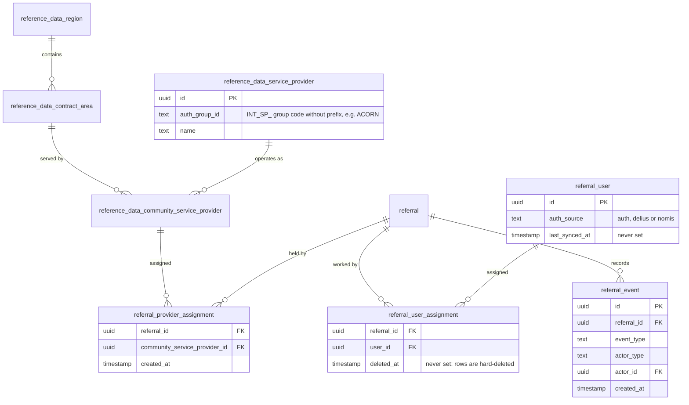
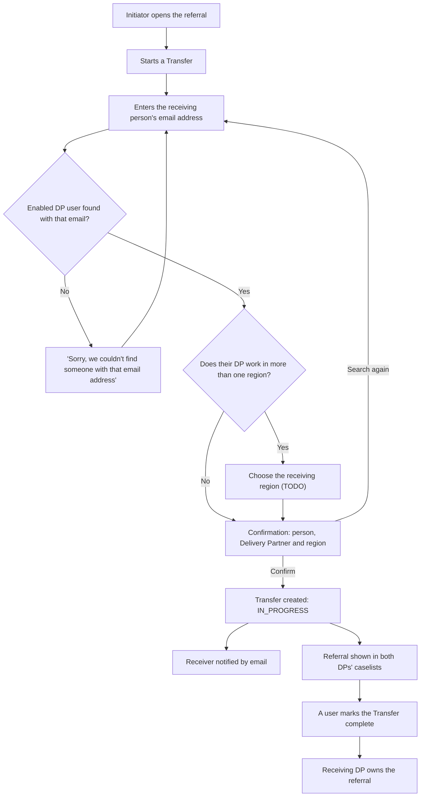
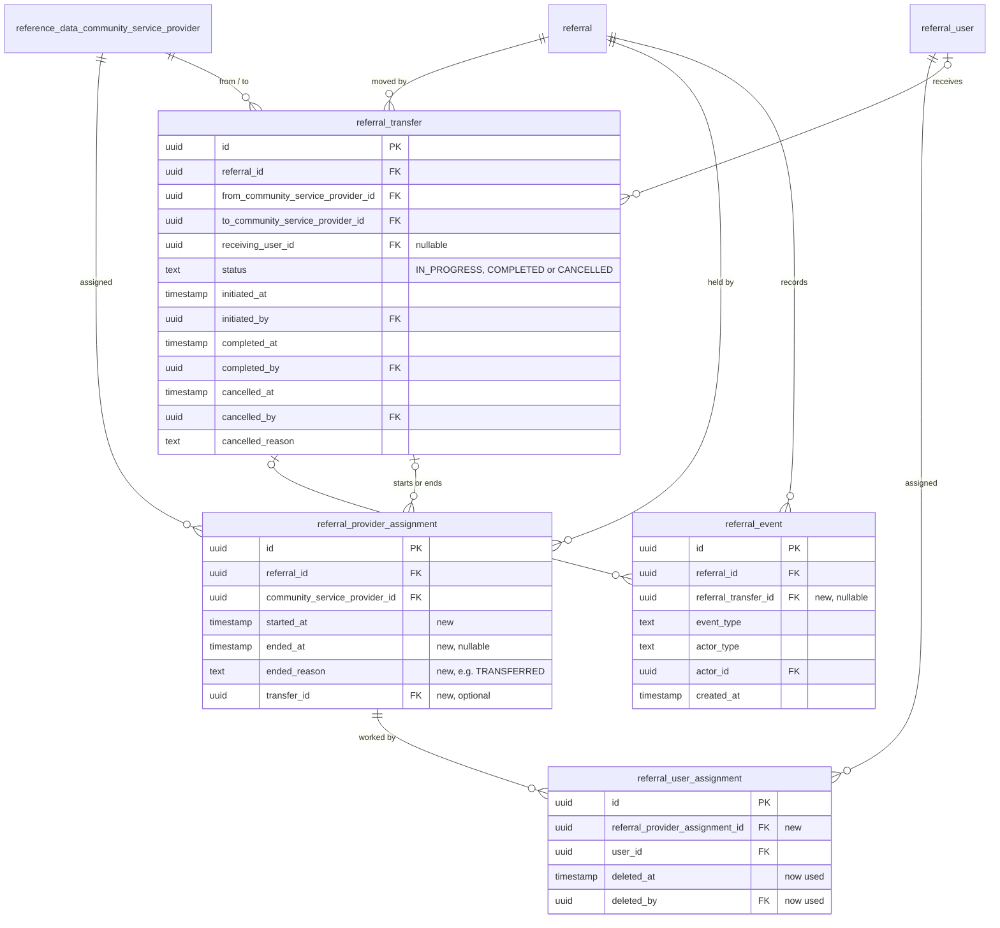
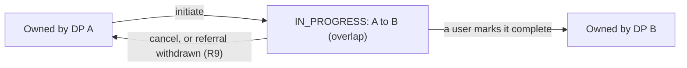
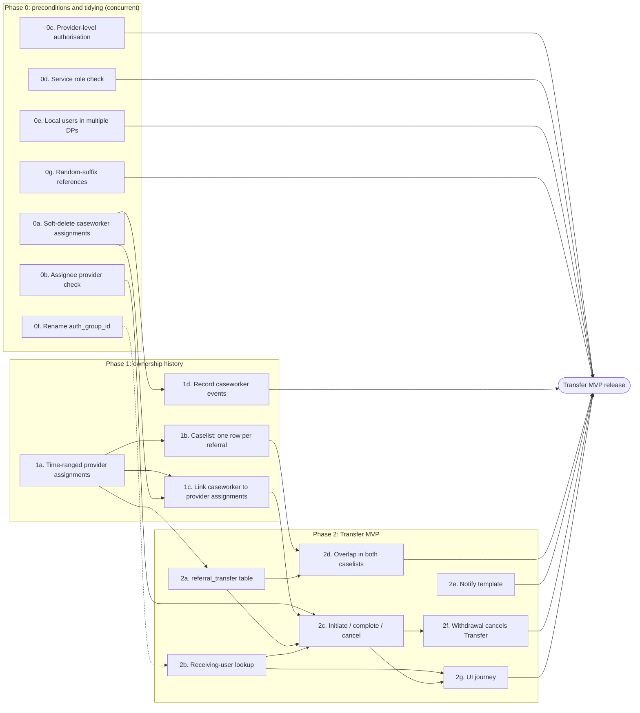

# Referral Transfers: High-Level Design

**Status:** Draft
**Audience:** Lead Tech, Technical Architect
**Last updated:** 2026-11

## Summary

When a Person on Probation moves region, their referral has to move (**Transfer**) to another Delivery Partner (DP). There is an overlap period during which both DPs see it. This document sets out both technical and product details on how we might achieve that.

**Where we are.** We have largely replicated the logic from the existing Refer and Monitor (R&M) codebase.  Each referral belongs to one provider, and its caseworker assignments are overwritten whenever they change, so we have no ownership history. The caselist view breaks if a referral has two providers. Some common-sense authorisation checks a Transfer depends on are missing: caseworkers can be assigned across DPs, and access to a referral isn't checked by provider (see [Implications for Transfer](#implications-for-transfer)).

**Recommendation.** Add an explicit `referral_transfer` record (`IN_PROGRESS → COMPLETED | CANCELLED`), which a user completes manually. Make provider and caseworker assignments append-only periods of ownership. Record every state change in the existing `referral_event` table. Publishing events on the HMPPS Domain Events queue to other services is deferred until there is a consumer (see [Ownership & Transfer model](#ownership--transfer-model)).

**Journey.** The person starting a Transfer already knows who should receive it, because that is agreed outside the service. They enter the receiver's email address, we show which DP that person belongs to, and they confirm or search again (see [The Transfer journey](#the-transfer-journey)).

**Users.** Keep one HMPPS Auth group per DP (`INT_SP_`, shared with Refer & Monitor) and add a role check for this service. Rename `auth_group_id` to `auth_group_code`. Local tooling currently can't create users in more than one DP; [User provisioning by environment](#user-provisioning-by-environment) fixes that and sets out how dev, preprod and prod accounts are provisioned.

**Delivery.** Start with preconditions and tidying, which can mostly run concurrently, then ownership history, which blocks the Transfer MVP (see [Implementation order](#implementation-order)).

**Decisions needed.** 13 [product questions](#product-decisions-needed) and 9 [technical questions and risks](#open-technical-questions--risks). The most important are: who completes a Transfer, how the receiving region is chosen when a DP works in several regions, and how a PP gets visibility of a referral created before release from custody (T1).

## Context & glossary

A **Referral** records the needs of a Person on Probation and the support they get as they leave custody and live in the community. Ministry of Justice (MoJ) staff create referrals; external **Delivery Partners** deliver the support. When the person moves region, the referral has to move to a Delivery Partner that covers the new region. That move is a **Transfer**. It's the next-but-one piece of work, expected early in 2027..

| Term | Meaning | In the code |
| --- | --- | --- |
| Person on Probation (POP) | The person the referral is about | `person` |
| Probation Practitioner (PP) | MoJ staff managing a person in the community. Their accounts are managed in nDelius. | `auth_source = delius`. The caselist treats these users as referrers. |
| Prison Offender Manager (POM) | MoJ staff managing a person in custody. Their accounts come from NOMIS (which the wider MoJ is exiting) or Digital Prison Services (DPS). A POM is **not** interchangeable with a PP. | `auth_source = nomis`. Not handled separately today. |
| Delivery Partner (DP) | An external organisation, under contract, that delivers support. Its staff are external HMPPS Auth users. | `reference_data_service_provider`, `auth_source = auth` |
| Community Service Provider | A DP operating in one contract area. One DP can operate in several regions. | `reference_data_community_service_provider` |
| Region / Contract area | Geography. A contract area belongs to a region. | `reference_data_region`, `reference_data_contract_area` |
| Caseworker | A DP staff member assigned to a referral | `referral_user_assignment` |
| Caselist | The referrals a user sees on their home screen | `case_list_view`, `CaseListController` |
| Transfer | Moving a referral from one DP to another | `referral_transfer` (proposed) |
| Original / Receiving DP | The DP a Transfer moves the referral from, and the DP it moves to | |
| Overlap period | The time during a Transfer when both DPs see the referral | |
| Owner | The DP that currently holds, and is accountable for, the referral | Proposed: the open `referral_provider_assignment` |
| Recording an event | Writing a row to our own `referral_event` table | `ReferralEvent` |
| Publishing an event | Sending an HMPPS domain event to other services (e.g. via `hmpps-domain-events`) | Not done today |

## Current state: assignment and the caselist

This section describes the system as it stands (November 2026). It is the baseline that the [Ownership & Transfer model](#ownership--transfer-model) changes.

### How the caselist is built

The UI calls two endpoints on `CaseListController`, both backed by `CaseListService`:

| Endpoint | Returns |
| --- | --- |
| `GET /bff/case-list/unassigned` | Referrals in the user's providers with **no** active caseworker |
| `GET /bff/case-list/in-progress` | Referrals in the user's providers with **at least one** active caseworker |

How visibility is scoped depends on the user's auth source:

- **`delius` users (PPs)** see the referrals they created (`referral.created_by`).
- **Every other auth source** is treated as Delivery Partner staff. They see referrals belonging to *any* provider they are a member of. Membership is resolved on every request by `ServiceProviderAccessScopeMapper`. It fetches the user's groups from manage-users, keeps those prefixed `INT_SP_`, and matches the remainder to `reference_data_service_provider.auth_group_id`. This pattern was inherited from Refer & Monitor.
- **POMs (`nomis` users)** therefore fall into the Delivery Partner path. They have no `INT_SP_` group, so the caselist rejects them. POMs are not supported as a distinct user type today (T1).

"In progress" therefore means "assigned to *someone* in my organisation", not "assigned to me". There is no per-user caselist today.

Both endpoints read from `case_list_view`, a materialised view refreshed every 5 minutes by `CaseListViewRefreshService`. The caselist can be up to 5 minutes out of date. In the view, `date_assigned` is the earliest *currently active* assignment, so it resets whenever the caseworkers change.

### The data model

A Delivery Partner (`reference_data_service_provider`) is the organisation and holds `auth_group_id`. A Community Service Provider is that organisation operating in one contract area.

- **`referral_provider_assignment`** has `referral_id`, `community_service_provider_id` and `created_at`. There is no end date, no actor and no status. The schema allows many rows per referral, but in practice there is exactly one: during drafting, `upsertCommunityServiceProvider` hard-deletes any existing rows before inserting (see the code comment referencing IPB-2532) - this behaviour will need to change to soft deletes.
- **`referral_user_assignment`** has soft-delete columns (`deleted_at`, `deleted_by`), but `assignCaseWorkers` **hard-deletes every assignment for the referral and re-inserts the submitted set**. Assignment history is lost on every change.
- **`referral_event`** records `CREATED`, `SUBMITTED`, `UPDATED`, `APPOINTMENT_FEEDBACK_SENT` and `WITHDRAWN`. Each row holds only the type, the actor and the time; there is no payload. `event_type` is free text, so new types need no migration. No event records assignment or ownership changes.
- **`referral_user`** is a local cache created on first sight of a user. `last_synced_at` is never set, so a changed name or email in HMPPS Auth is never picked up.  We will need to handle this in the future, as changing names and emails is not particularly unusual.

### Current technical implications or limitations

Some aspects about our codebase

1. **A second provider assignment would break the caselist.** `case_list_view` groups by `community_service_provider_id` and has a unique index on `referral_id`. A referral with two provider assignments produces two rows with the same `referral_id`. `REFRESH MATERIALIZED VIEW CONCURRENTLY` then fails, and every user's caselist stops updating.
2. **Caseworkers can be assigned across Delivery Partners.** `assignCaseWorkers` looks up the assignee by email and does not check that they belong to the referral's provider. Any HMPPS Auth user can be assigned to any referral. Transfer makes cross-provider assignment a deliberate feature, so this check needs to exist first.
3. **There is no per-referral authorisation by provider.** `ServiceProviderAccessScopeMapper` is only used by the caselist. Fetching a referral by ID or reference number does not check that the user's provider owns it. This matches other services in our area and is low-risk while identifiers are UUIDs. However, referrals can also be looked up by reference number (item 5 below), which is far easier to guess. The likely eventual feature requirement that "previous DPs can view a transferred referral, but in read-only mode" will likely be an addition to this, suggesting the foundations are important.
4. **History is not retained.** Provider assignments have no start or end, and caseworker assignments are hard-deleted on every change. We can't answer "who owned or worked on this referral on date X?". Stakeholders will ask, for reporting and for disputes about who held a case.
5. **The reference number encodes the original Delivery Partner.** References are `[2 letters][4 digits][first 2 letters of the service provider name]`, for example `AB1234XY`. After a Transfer the suffix points to the wrong partner, which could confuse people. The prefix uses 24 letters (no I or O), giving at most 24² × 10⁴ ≈ 5.8M combinations per provider, fewer after ambiguous characters are filtered out. We should probably change the way we generate our Case Reference strings. See [Referral reference numbers](#referral-reference-numbers).
6. **The "user not found" message reveals whether an account exists.** Assignment returns "Could not find a caseworker with that email address". This bears on how much feedback to give when searching for a receiving user (see [Finding the receiving user](#finding-the-receiving-user)).
7. **The caselist is up to 5 minutes stale.** This is acceptable today, but users will notice if a Transfer doesn't appear immediately in the receiver's list.  I think, realistically, we can use a non-materialised view to achieve the same performance with easier implementation.

## Requirements & assumptions

Stakeholders often add requirements late, so each item is marked with how likely it is to change.

### Hard requirements

| Requirement |
| --- |
| **R1 (stable)** A Transfer moves a referral from the Original DP to the Receiving DP when the POP changes region (prison→prison, custody→community, community→community). |
| **R2 (volatile)** There is an overlap period in which the referral appears (almost) equally in the caselists of both DPs. What "almost" means is a [product question](#product-decisions-needed). |
| **R3 (stable)** A Transfer is completed manually, when a user marks it complete. |
| **R4 (stable)** A referral can return to a DP it has already been with (A→B→C→A). |
| **R5 (stable)** Every ownership change is recorded, so we can say who owned a referral at any point in time. This supports reporting and disputes about who held a case. |
| **R6 (stable)** Every Transfer state change is recorded as an event in our own database, in line with the service's existing event-led approach. Publishing events to other services is not required for the MVP. |
| **R7 (stable)** The PP can see a referral's Transfer status and history. |
| **R8 (volatile)** A Transfer cannot be rejected by the receiver. It's assumed to have been agreed beforehand (e.g. by email). |
| **R9 (stable)** If a referral is withdrawn during a Transfer, the Transfer is cancelled and the referral stays with the Original DP. |

### Soft and deferred requirements

| Requirement |
| --- |
| **S1 (volatile)** The Transfer goes to a named individual at the Receiving DP rather than an organisational inbox. |
| **S2 (volatile)** A caseworker currently assigned to the referral, or the referral's PP, starts the Transfer. |
| **S3 (deferred)** After completion, the Original DP keeps read-only access to the referral. |
| **S4 (deferred, volatile)** Any DP that has ever held a referral can find it later to "check up" on the person. |
| **S5 (structural)** The Receiving DP can see which DPs previously held the referral. Contact happens outside the service (phone, email). |
| **S6 (structural)** The receiver is notified when a Transfer starts (GOV.UK Notify, as caseworker assignment does today). |
| **S7 (deferred)** The Receiving DP holds an active contract for the POP's new region. Contract renewal is over a year away, so the rules (including any grace period) are not specified yet. |
| **S8 (deferred)** Transfer events are published as HMPPS domain events for other services. |

### Assumptions

| Assumption |
| --- |
| **A1** Outside a Transfer, exactly one DP owns a referral at any time. |
| **A2** During the overlap, the **Original DP stays the owner** until the Transfer is completed. |
| **A3** At most one Transfer can be in progress per referral. |
| **A4** Expected total volumes of transfers low, from tens to low hundreds per month. The MVP can rely on manual intervention by a system admin user for edge cases. |
| **A5** Data-sharing agreements between DPs are handled outside the service. |
| **A6** Transfer arrived late in delivery, so the MVP should be as small as possible and leave room for the volatile and deferred requirements above. |
| **A7** The right person to receive a Transfer is identified **outside** the service, so the initiator already knows their email address. |

### Non-functional requirement

- **Changing the rules shouldn't need a schema change.** Who can initiate or complete a Transfer, and what each DP can do during the overlap, should be changeable through configuration or a small code change.

### Open questions raised here

These are carried into [Product decisions needed](#product-decisions-needed):

- Is a move between regions **within the same DP** (a different CommunityServiceProvider under the same ServiceProvider) a Transfer?
- Can the initiator **cancel** a Transfer that is in progress?
- When a DP's contract expires, do its open referrals have to transfer?

## The Transfer journey

The proposed journey relies on A7: the initiator has already agreed the Transfer with a named person at the Receiving DP. The service's job is to find that person and confirm where the referral is going, not to help the initiator choose a partner. UI and wording are to be confirmed.

1. The initiator (the current caseworker, or the PP) opens the referral and starts a Transfer.
2. They enter the email address of the person they are transferring to.
3. We look up that email address (see [Finding the receiving user](#finding-the-receiving-user)).
   - If no suitable user is found, we show a message such as "Sorry, we couldn't find someone with that email address", and they can search again.
   - If a user is found, we show a confirmation screen: "We found this person; here is their Delivery Partner".
4. The confirmation screen shows where the referral is being transferred to. The initiator either confirms, or goes back and searches again.
5. On confirmation, the Transfer is created as `IN_PROGRESS` and the receiver is notified (S6).

**To do:**

- **Choosing the region.** A Transfer targets a Community Service Provider (a DP in one contract area). If the receiver's DP works in several regions, we need to decide how the region is chosen: by the initiator, from the person's new address, or not at all (if region doesn't matter within a DP). This is a [product question](#product-decisions-needed).
- **Revealing that an account doesn't exist.** A specific "couldn't find" message is more helpful, but it tells the initiator whether an account exists for that email address. This is a [product question](#product-decisions-needed); see also [Finding the receiving user](#finding-the-receiving-user).
- **Users in more than one DP.** If the receiver belongs to several DP groups, we need to decide which DP the Transfer goes to (T8).

## Ownership & Transfer model

In order to model ownership (and transfers therein) of a referral, I propose we introduce an explicit **`referral_transfer`** record, and turn provider (and caseworker) assignments into **append-only periods of ownership**. The Transfer record holds *intent and state*: who started it, who receives it, and who completed or cancelled it. The assignment periods hold *ownership*: who owned the referral, and from when to when.

This is the smallest change that meets R5 (point-in-time history) and still absorbs the volatile requirements as configuration or code changes rather than schema changes.

### Alternatives considered

| Option | Summary | Why not |
| --- | --- | --- |
| A. Time-ranged assignments only | Add `started_at`/`ended_at`/`role` to `referral_provider_assignment`; no Transfer entity | Smallest change, but Transfer state (initiator, receiver, cancellation) has to be inferred from several rows. This gets fragile as soon as a requirement changes. |
| B. Event-sourced ownership | Derive ownership entirely from `referral_event` and build projections | Strongest audit story, but a large change in architecture. |
| C. Copy the referral per DP | Each DP gets its own referral record | Splits history across records and breaks R5 and R7. Rejected. |

### Data model changes

**New: `referral_transfer`**

| Column | Notes |
| --- | --- |
| `id`, `referral_id` | |
| `from_community_service_provider_id`, `to_community_service_provider_id` | Both CommunityServiceProviders, so a same-DP region change can be represented (see [Open questions raised here](#open-questions-raised-here)) |
| `receiving_user_id` | The named individual (S1). Nullable, in case S1 changes to an inbox model. |
| `status` | `IN_PROGRESS` → `COMPLETED` \| `CANCELLED` |
| `initiated_at`, `initiated_by` | |
| `completed_at`, `completed_by` | The user who marked the Transfer complete |
| `cancelled_at`, `cancelled_by`, `cancelled_reason` | For example `REFERRAL_WITHDRAWN` (R9) |

A partial unique index on `(referral_id) WHERE status = 'IN_PROGRESS'` enforces at most one Transfer in progress per referral (A3).

**Changed: `referral_provider_assignment`**

- Add `started_at`, `ended_at` (nullable) and `ended_reason` (e.g. `TRANSFERRED`), and optionally `transfer_id`.
- Rows are never deleted after submission. The referral's current owner is the row where `ended_at IS NULL`. During a Transfer the Receiving DP is *not* yet the owner; it reaches the record through the Transfer.
- Ownership at time T is the row where `started_at <= T AND (ended_at IS NULL OR ended_at > T)`.

**Changed: `referral_user_assignment`**

- Link each caseworker assignment to the provider assignment it belongs to.
- **Fix:** `assignCaseWorkers` should soft-delete, using the existing `deleted_at`/`deleted_by` columns, instead of hard-deleting and re-inserting.
- When a Transfer completes, the Original DP's caseworker assignments are ended with the reason `TRANSFERRED`, and the receiving user becomes the caseworker under the new provider assignment.

**Changed: `referral_event`**

- Add a nullable `referral_transfer_id` (see [Where to record Transfer events](#where-to-record-transfer-events)).

### Lifecycle

- **Initiate:** create a `referral_transfer` with status `IN_PROGRESS`, notify the receiving user (S6), and record `TRANSFER_INITIATED`.
- **Complete:** a user marks the Transfer complete through a single endpoint. Completing ends A's provider assignment and its caseworker assignments, starts B's provider assignment, assigns the receiving user, and records `TRANSFER_COMPLETED`. Who is allowed to complete is a [product question](#product-decisions-needed) and an authorisation rule, not a data model change.
- **Cancel:** set `cancelled_*`. Ownership doesn't change. Record `TRANSFER_CANCELLED`.

Completion and cancellation should use a conditional `UPDATE … WHERE status = 'IN_PROGRESS'`, so a double submission can't complete or cancel a Transfer twice.

### Access and the caselist

A user's access to a referral is **derived** from the assignment and Transfer records, not stored:

| Access | Who | Rights |
| --- | --- | --- |
| `OWNER` | Members of the provider with the open provider assignment | Full |
| `INCOMING` | Members of the `to` provider of a Transfer in progress | Overlap rights: "(almost) equal" (R2); exact rights are a product question |
| `PREVIOUS` | Members of a provider with an ended assignment | Read-only (S3, deferred) |

Caselist changes:

- `case_list_view` must produce **one row per referral**, fixing the failure described in item 1 of [Implications for Transfer](#implications-for-transfer). Add `owning_service_provider_id`, `incoming_service_provider_id` (nullable) and `transfer_status`.
- During the overlap, both DPs see the referral, flagged as transferring (a tab or a filter in the UI).
- At expected volumes, consider replacing the materialised view with a plain view or query, so a new Transfer appears immediately instead of after up to 5 minutes.

### Recording and publishing events

This design distinguishes two things:

- **Recording** an event means writing a row to our own `referral_event` table, in the same database transaction as the state change. This is part of the MVP (R6).
- **Publishing** an event means sending an HMPPS domain event to other services, for example via the `hmpps-domain-events` topic. Each published event must carry a `detailUrl` pointing to an endpoint that returns the full payload. The service doesn't publish domain events today, so this is new infrastructure (an SNS topic and the `hmpps-sqs` library). It is **not** part of the MVP (S8), and we should defer the decision until a consumer needs it.

New event types to record:

- `TRANSFER_INITIATED`
- `TRANSFER_COMPLETED`
- `TRANSFER_CANCELLED`
- `CASEWORKER_ASSIGNED`
- `CASEWORKER_UNASSIGNED`

Because events are recorded in the same transaction as the change, `referral_event` can later act as an outbox for a publisher. Deferring publication doesn't close that route.

#### Where to record Transfer events

| Option | For | Against |
| --- | --- | --- |
| **Extend `referral_event`** with a nullable `referral_transfer_id` and new event types | One chronological timeline per referral, which is what R5 and R7 (history shown to the PP) need. `event_type` is free text, so only the new column needs a migration. Caseworker events are referral-level and belong here anyway. | Most rows will have a null `referral_transfer_id`. |
| **New `transfer_event` table** | Transfer events are isolated, and could carry their own columns. | Splits the referral's timeline across two tables, so showing history needs a `UNION`. Duplicates the actor and timestamp structure. The extra columns aren't needed, because the detail (from, to, receiver, who and when) is already on `referral_transfer`. |

**Recommendation: extend `referral_event`.** It's the clear choice. Transfer events only need to point at the `referral_transfer` row, which holds the detail. A separate table would only win if Transfer events needed their own payload or retention rules, and nothing suggests they do. Because all completions are manual, every event has a real user as its actor, so the existing `actor_type`/`actor_id` columns are enough.

### Referral reference numbers

The reference number ends in the first two letters of the service provider's name (see item 5 of [Implications for Transfer](#implications-for-transfer)). Once a DP can change, that suffix is at best meaningless and at worst misleading.

| Option | Assessment |
| --- | --- |
| Keep the format; tell people the suffix has no meaning | No work, but staff will keep reading the suffix as the current DP. |
| **Replace the suffix with two more random letters** (`AB1234CD`) | Same 8-character shape, so UI validation and search are unchanged. No DP meaning. Raises the space from about 5.8M per provider to about 3.3bn (24⁴ × 10⁴), making references harder to guess. |
| Encode something else (region, service category) | Region has the same problem after a Transfer; category adds little. |
| Sequential numbers | Simple, but trivially enumerable. |

**Recommendation:** generate new references with a random suffix, using the same reduced alphabet and ambiguity filter. A reference never changes over a referral's life. Existing references keep their current suffix, because they have already been quoted in correspondence. Also add a unique constraint on `referral.reference_number` (today uniqueness is checked only in code), and rename `ReferralReferenceGenerator.generate`'s `categoryName` parameter, which actually receives the service provider name.

### Other decisions

- **Same-DP region change:** the model represents it either way (same ServiceProvider, different CommunityServiceProvider). Whether it *counts as* a Transfer is a [product question](#product-decisions-needed).

### Preconditions

These come from [Implications for Transfer](#implications-for-transfer) and must be done before or alongside Transfer:

1. Check that the assignee belongs to the referral's owning provider when assigning caseworkers. The receiving user is held on the Transfer (`receiving_user_id`) and only becomes a caseworker on completion (see [Data model changes](#data-model-changes)).
2. Provider-level authorisation when fetching a referral by ID or reference number.
3. Soft-delete in `assignCaseWorkers`.
4. Require this service's user role (e.g. `COMMUNITY_SUPPORT_PROVIDER`) as well as an `INT_SP_` group, because the group prefix is shared with Refer & Monitor (see [Recommended model](#recommended-model)). Today the API only checks the UI client's `ROLE_IPB_FRONTEND_RW`.

## External users & Delivery Partner membership

### How the platform models external users

Delivery Partner staff are **external users** (`auth_source = auth`). Their accounts live in `hmpps-external-users-api`. `hmpps-manage-users-api` proxies to it and is the API we call. PPs (`delius`) and POMs (`nomis`) come from different sources, and we can tell from the token which source the logged-in user came from.

- **Groups are the only organisation concept.** There is no "company" entity. Groups are flat; child groups are possible. A user can belong to several groups.
- **Roles say what a user can do; groups say who they work for.** Roles are global. Groups can be administered per organisation (see group managers below). So DP membership belongs in a group, not a role.
- **The username is the email address**, uppercased. Changing a user's email changes their username and resets email verification. The `hmppsAuthId` UUID is the only stable identifier. `referral_user` already keys on it, but `UserService.getUser` looks users up by cached username first.
- **Accounts are auto-disabled after 90 days** of inactivity.
- **Nothing is published when a user changes.** Enable, disable and email changes produce telemetry only, not domain events, so we can't react to them.
- **Email domains are allow-listed** (`email_domain`). Onboarding a new DP includes adding its domain.
- **Administration:** `ROLE_MAINTAIN_OAUTH_USERS` can manage any external user. `ROLE_AUTH_GROUP_MANAGER` can manage only users who share a group with them, including creating users, assigning groups and roles, and enabling or disabling accounts. This allows DP leads to administer their own staff later.

### Recommended model

| Concept | Platform primitive | Example |
| --- | --- | --- |
| Delivery Partner membership | Group, one per DP | `INT_SP_ACORN` → `reference_data_service_provider.auth_group_code = 'ACORN'` |
| Access to this service | Role | `COMMUNITY_SUPPORT_PROVIDER` |
| Region within a DP | *Not modelled (deferred)* | Could later use child groups or contract groups (`INT_CR_…`, as Refer & Monitor does) |

This is the existing model (see [How the caselist is built](#how-the-caselist-is-built)), apart from the column rename below.

**The `INT_SP_` prefix is deliberately shared with Refer & Monitor.** Both services will run in parallel for a period (women's services), and DP staff may use both. Because of that, a group alone mustn't grant access to this service: the user also needs this service's role. Group codes must stay consistent between the two services' reference data.

**Production administration:** MoJ admins with `ROLE_MAINTAIN_OAUTH_USERS` create accounts, add the DP group and role, and add email domains for new DPs. Delegating to a group manager at each DP is a possible later step and needs no model change.

### Renaming `auth_group_id`

`reference_data_service_provider.auth_group_id` holds an HMPPS Auth group code with the `INT_SP_` prefix removed (e.g. `ACORN`). It isn't an identifier in the UUID sense, and the name suggests it is.

| Option | Assessment |
| --- | --- |
| Keep `auth_group_id` | No work, but misleading. |
| **`auth_group_code`** | Matches the platform's own term (`groupCode`) for exactly this value. |
| `auth_group_name` | The platform's `groupName` is the display name (e.g. "Acorn"), so this would be confused with it. |

**Recommendation: rename to `auth_group_code`.** It's the clear choice. Keep storing the code without the `INT_SP_` prefix, and say so in the column comment; storing the full code would change the mapper and seed data for little benefit. The change is a Flyway `RENAME COLUMN`, plus the entity field, the `AuthGroupID` type alias (to `AuthGroupCode`), `ServiceProviderRepository.findAllByAuthGroupIdIn` and the related tests. The caselist view doesn't reference the column. Do this early, before other precondition work touches the same code.

### Finding the receiving user

This supports [The Transfer journey](#the-transfer-journey). The MVP uses **exact email lookup only**:

1. Look up the user by email: `GET /externalusers?email=`.
2. Check they are enabled, and fetch their groups: `GET /externalusers/{userId}/groups`. Our API client can already call this.
3. Match their `INT_SP_` groups to `reference_data_service_provider.auth_group_code` to find their DP, then find that DP's Community Service Providers to determine the receiving region (see the to-do list in [The Transfer journey](#the-transfer-journey)).
4. If no enabled user with a matching DP group is found, return a "not found" response. Whether the UI shows a specific message ("Sorry, we couldn't find someone with that email address") or a generic one is a [product question](#product-decisions-needed), because a specific message reveals whether an account exists (see item 6 of [Implications for Transfer](#implications-for-transfer)). The lookup is only available to authenticated users with this service's role, which limits the risk; we could also log lookups.

Searching by name or browsing a DP's staff would need our API client to hold `ROLE_MAINTAIN_OAUTH_USERS` or `ROLE_AUTH_GROUP_MANAGER`. Those are admin roles and too broad to give a service client. Because the receiver is identified outside the service (A7), search shouldn't be needed. If product still wants it, the safer option is our own directory of DP users built from `referral_user`. Its limitation is that it only contains people who have logged in at least once.

### Keeping user data current

- Refresh `referral_user` (name, username/email, `last_synced_at`) on each login and each lookup. Treat `hmppsAuthId` as the key and the username as a value that can change.
- A Transfer that names a user who is later disabled is still valid, because ownership is held by the DP. Unassigned or orphaned referrals should show up in the receiving DP's "unassigned" list, which already exists, rather than being lost.
- **Refer & Monitor** checked that a user's contract groups belonged to their provider groups and recorded mismatches as warnings. That's worth reusing if we add region-level groups; otherwise it isn't needed.

## User provisioning by environment

Testing a Transfer needs users in **at least two Delivery Partners**. Neither local mode supports that today:

- **Wiremock** (`wiremock_mappings/manageUsersMock.json`) gives every user the same group, `INT_SP_TEST`, so there is only ever one DP.
- **The real auth + manage-users stack** (`docker-compose*.yml`, `scripts/local-user-setup.sh`) assigns roles but **no group**, so the user belongs to no DP and the caselist rejects them.

### Local

1. Extend `local-user-setup.sh` to accept a group, e.g. `--group INT_SP_ACORN`. It should create the group if it doesn't exist and add the user to it.
2. Add a single **Transfer fixture** command that creates a known set of users: two users in DP A, one in DP B, one in both, one disabled user, and one PP (Delius).
3. Make the wiremock stub return groups based on the username (e.g. `*@acorn.test` → `INT_SP_ACORN`), so a second DP can be tested without the full stack.
4. Seed local data (`db/local`) with referrals held by at least two DPs in different regions, at least one DP that works in more than one region, and one Transfer in progress.
5. Use fixed passwords and stable emails so e2e tests can rely on them.
6. Document both modes in the README: wiremock for API work, the real stack for UI and permissions work.

### Dev (shared)

7. Members of the team are admins in DPS Manage Users and can create test users in dev without help from another team.
8. Use **test-only DP groups** (e.g. `INT_SP_TEST_A`, `INT_SP_TEST_B`) that match reference data seeded only in dev. Don't add test users to real DP groups.
9. Reuse the local provisioning script against dev, by changing the URL and token.
10. Dev accounts are disabled after 90 days of inactivity. The script should re-enable its accounts, or the README should explain how.
11. Store credentials as **Kubernetes secrets**, and also as **GitHub repository secrets** where CI integration or e2e tests need them. Keep a register of each shared test account (owner and purpose) next to the script, without the credentials.

### Preprod

12. Preprod mirrors prod's reference data, so only real DP groups exist there.
13. Accounts are created by admins, as in prod. Preprod is the place for UAT with DP staff, if product wants that.

### Prod

14. **Onboarding a DP** is a checklist for an MoJ admin: allow-list the email domain, create the `INT_SP_` group (or reuse the one shared with Refer & Monitor), add the `reference_data_service_provider` row through a migration, then create users with the group and role.
15. Keep a single source of truth for group codes that both this service and Refer & Monitor use.
16. **Offboarding:** when a DP's contract ends, remove the group or disable its accounts. The timing depends on the contract-expiry question (see [Product decisions needed](#product-decisions-needed)).
17. There are no test accounts in prod.

## Trade-offs & incremental delivery

### Implementation order

Each phase can be released on its own. Phases 0 and 1 aren't visible to users; phase 2 is.

**Phase 0: preconditions and tidying.** All items are independent of each other and can run concurrently:

- 0a. Soft-delete in `assignCaseWorkers`.
- 0b. Check that the assignee belongs to the owning provider.
- 0c. Provider-level authorisation when fetching a referral.
- 0d. Service role check (see [Preconditions](#preconditions)).
- 0e. Local users in multiple DPs (see [Local](#local)).
- 0f. Rename `auth_group_id` to `auth_group_code` (see [Renaming `auth_group_id`](#renaming-auth_group_id)). Best done before other work touches the same code.
- 0g. Random-suffix reference numbers (see [Referral reference numbers](#referral-reference-numbers)).

**Phase 1: ownership history.**

- 1a. Time-ranged `referral_provider_assignment` records. **This is the main blocking item**: most of phases 1 and 2 depend on it.
- 1b. Caselist view returns one row per referral (needs 1a).
- 1c. Link caseworker assignments to provider assignments (needs 0a and 1a).
- 1d. Record `CASEWORKER_ASSIGNED` and `CASEWORKER_UNASSIGNED` events (needs 0a).

**Phase 2: Transfer MVP.**

- 2a. `referral_transfer` table and `referral_event.referral_transfer_id` (needs 1a).
- 2b. Receiving-user lookup by email, including region resolution (see [Finding the receiving user](#finding-the-receiving-user)). Can start at any time.
- 2c. Initiate, complete and cancel endpoints, recording events (needs 0b, 1c, 2a and 2b).
- 2d. Show the overlap in both caselists (needs 1b and 2a).
- 2e. Notify template for "Transfer received". Content work can start at any time.
- 2f. Withdrawing a referral cancels its Transfer (needs 2c).
- 2g. UI journey (needs 2b and 2c for integration; design can start at any time).

The critical path is **1a → 2a → 2c → 2f → release**. Phase 0 items, 2b, 2e and the UI design can all run alongside it.

Solid arrows mean "must be finished first"; the dotted arrow means "preferably first". Items with no path between them can be built concurrently.

**Deferred:** publishing domain events with `detailUrl` (S8); read-only access for previous DPs (S3, needs 0c); "check up" (S4); name search; and contract expiry.

### Trade-offs

1. **Allow manual or admin fallbacks in the MVP (A4).** This ships sooner, but creates operational work. Database fixes leave gaps in the audit trail, so fallbacks should go through an endpoint that records events.
2. **Use approach B instead of A (see [Alternatives considered](#alternatives-considered)).** This absorbs volatile requirements but requires more upfront work.
3. **Record events and history from phase 1.** This gives complete history from day one (R5), at a small extra cost now. Data that has already been lost cannot be filled in later.
4. **Record events now, publish later.** This keeps the MVP free of new infrastructure. Because events are recorded transactionally, a publisher can be added later without losing anything.
5. **Replace the materialised view with a plain view.** This removes the 5-minute delay, but makes queries more expensive. This should be acceptable at the expected volumes, subject to measurement.
6. **Use exact email lookup only.** This needs no admin role for our client, but is less convenient. The initiator must already know the receiver's email, which is consistent with A7 and R8 (agreed beforehand).

### Resilience to late requirements

Examples of plausible late changes and their cost under the recommended model:

1. **The receiver can reject a Transfer:** Add a `REJECTED` status, an endpoint, a `TRANSFER_REJECTED` event and a Notify email to the initiator. Ownership does not need to change.
2. **Who can initiate or complete changes:** Change an authorisation rule. A PP is not a member of any DP, so a PP rule depends on how MoJ staff are linked to a referral (T1).
3. **Transfers go to a DP inbox instead of a named person:** This is supported because `receiving_user_id` is nullable and the "unassigned" list already exists.
4. **Previous DPs get read-only access:** Add the `PREVIOUS` access level (see [Access and the caselist](#access-and-the-caselist)). This depends on provider-level authorisation (0c).
5. **Other services need Transfer events:** Add a publisher that reads recorded events, and a `detailUrl` endpoint such as `GET /referral/{id}/transfers/{transferId}`.
6. **The receiving region is chosen differently:** Only the rule that sets `to_community_service_provider_id` changes.

## Product decisions needed

These are written for product. Each one changes behaviour, but the recommended design can accommodate any answer.

**The overlap period**

1. Who marks a transfer as complete: the new partner, the old partner, the probation practitioner, or any of them?
2. During the transfer, what can each partner do with the case? For example, both have full access, or the old partner can only view.
3. Can the person who started a transfer cancel it? Up to what point?

**Who and how**

4. Who can start a transfer: the current caseworker, the probation practitioner, or both?
5. Is entering the new caseworker's email address enough? We are assuming the right person is agreed outside the service, so no search by name.
6. If an email address doesn't match anyone, should we say so specifically ("Sorry, we couldn't find someone with that email address") or give a general message? The specific message is more helpful, but it tells people whether an account exists.
7. If the new partner works in more than one region, how is the region chosen: by the person starting the transfer, from the person on probation's new address, or does it not matter?
8. If someone moves to a new region but stays with the **same** delivery partner, is that a transfer?

**After the transfer**

9. Should former partners still be able to find or view the case? Indefinitely, or for a set time?
10. What should the probation practitioner see about a case's transfers?
11. We propose that new reference numbers no longer contain letters from the partner's name. Does anyone rely on those letters today?

**Contracts and reporting**

12. When a partner's contract ends, what happens to the cases it is still working on?
13. What do you need to report on transfers, e.g. number per partner, or time spent in transfer?

## Open technical questions & risks

- **T1 — PP visibility is based on `created_by`, and POMs aren't a distinct user type.** A PP (`delius`) and a POM (`nomis`/DPS) are different accounts from different sources, so they can't be treated as the same user. Release from custody often hands a case from a POM to a PP, and the new PP can't see referrals they didn't create.
  *Risk:* Not caused by Transfer, but likely to come up at the same time as custody→community moves. Needs its own design (e.g. resolving the responsible PP from Delius, and deciding how POMs are supported).
- **T2 — Provider-level authorisation:** Where is it enforced (a service-level helper or Spring method security), and how does it apply to PP endpoints?
  *Precondition (see [Preconditions](#preconditions)):* Design once and reuse for `PREVIOUS` access.
- **T3 — Backfilling data:** Existing provider assignments get `started_at = created_at`; past caseworker assignment history can't be recovered.
  *Mitigation:* Say so explicitly when we're asked for history from before the change.
- **T4 — Materialised view versus plain view:** Query cost at expected volumes.
  *Action:* Measure before phase 1, which rebuilds the view anyway.
- **T5 — `UserService.getUser` looks users up by cached username first, so it breaks after an email change.**
  *Fix:* Apply [Keeping user data current](#keeping-user-data-current) (re-sync on lookup).
- **T6 — `INT_SP_` group codes must match Refer & Monitor's reference data.**
  *Action:* Check the existing codes are consistent before phase 2.
- **T7 — A Notify template is needed for "Transfer received".**
  *Dependency:* Content agreed with product or design.
- **T8 — Receiving users in more than one DP group.** The lookup resolves the receiving DP from the user's groups, so a user in several DPs is ambiguous.
  *Options:* Ask the initiator to choose, or treat it as "not found" for the MVP.
- **T9 — Publishing domain events (deferred):** SNS topic, event schema, `detailUrl` endpoints and known consumers.
  *Dependency:* New to this service; size separately when a consumer exists.

## Appendix A: Investigation brief

This document came from an investigation by an LLM assistant (GitHub Copilot CLI) working with the team, using this brief:

1. Describe how the caselist currently works, starting from `CaseListController.getInProgressCases`. → [Current state](#current-state-assignment-and-the-caselist)
2. Propose a minimal data model change that makes "assignment" and "ownership" explicit and allows an overlap period that ends when a user marks the Transfer complete. → [Ownership & Transfer model](#ownership--transfer-model)
3. Look at `hmpps-auth`, `hmpps-manage-users-api` and `hmpps-external-users-api` to find a sensible model for managing Delivery Partner users and assigning them to DPs. → [External users & Delivery Partner membership](#external-users--delivery-partner-membership)
4. Propose a framework for managing users locally, in shared development environments and in production. → [User provisioning by environment](#user-provisioning-by-environment)

Repositories examined: this repository, `hmpps-auth`, `hmpps-manage-users-api`, `hmpps-external-users-api`, and `hmpps-interventions-service` (Refer & Monitor), all as of November 2026. Statements about the code describe it at that time.

## Appendix B: Notes on Refer & Monitor (prior art)

Refer & Monitor (`hmpps-interventions-service`) is this team's legacy service. The team has chosen to move away from it, so it's a reference for how things were done, not a recommendation.

- This service's `ServiceProviderAccessScopeMapper` is adapted from Refer & Monitor's. Refer & Monitor also resolves **contract** groups (`INT_CR_`) and checks that each contract belongs to one of the user's providers, recording mismatches as warnings.
- The two services deliberately **share** `INT_SP_` group codes while they run in parallel (see [Recommended model](#recommended-model)).
- Nothing else from Refer & Monitor's assignment or transfer approach is adopted here.
